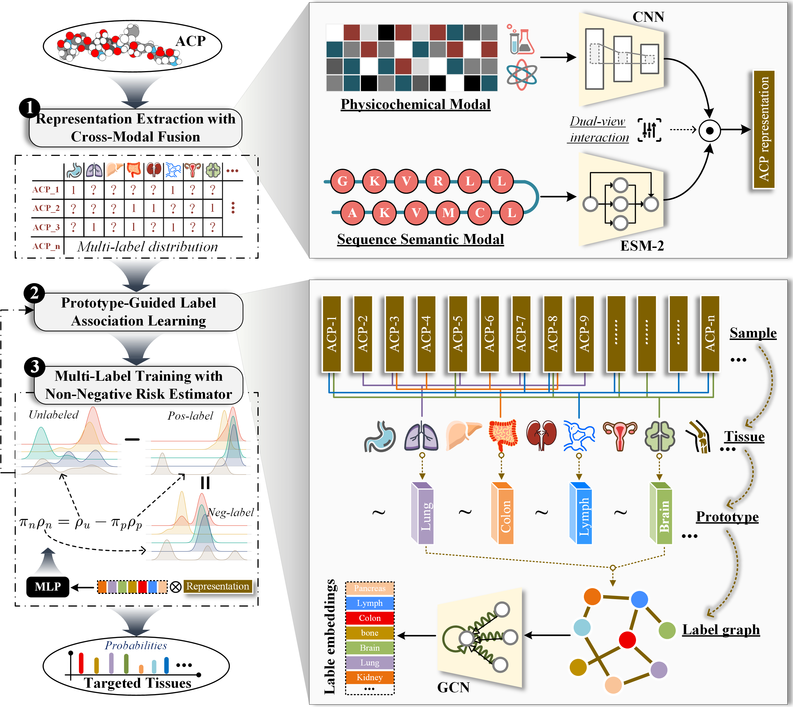

# ATfinder

Tissue-target prediction for anticancer peptides using frozen ESM-2 embeddings, physicochemical CNN features, prototype-based label graph learning, and nnPU loss.



## Install

```bash
pip install -r requirements.txt
```

## Data

`data/` contains the 1,953-sequence, 12-label dataset, original five-fold and independent-test splits, and its matching 640-dimensional ESM-2 feature cache.

## Run

```bash
python train.py --device cuda
python eval.py --checkpoint runs/fold_1/final_model.pt --device cuda
```

To regenerate the ESM cache with the official `esm2_t30_150M_UR50D` weights (optional):

```bash
python extract_esm.py --device cuda
```

## Citation

Liu et al. *Identifying Tissue Targets of Anticancer Peptides under Weakly Supervised Multi-Label Learning* (2026). MIT License.
